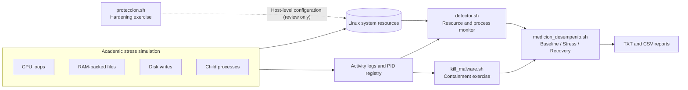

<div align="center">

# 🛡️ Linux Security & Resource Stress Lab

**An academic operating-systems lab for observing resource exhaustion, detecting anomalies, investigating process behavior, and comparing system performance before and after containment.**


**[Español](README.es.md) · [Architecture](docs/ARCHITECTURE.md) · [Security Review](docs/SECURITY_REVIEW.md) · [Demonstration Guide](docs/DEMO_GUIDE.md) · [Publishing](PUBLISHING.md)**

</div>

> [!IMPORTANT]
> **This is NOT a real computer virus, antivirus, or production-ready security tool.** It simulates *malware-like resource-exhaustion behavior* in Bash. The original coursework scripts are preserved for review and have **known safety limitations**. **Do not run the stress simulator, kill switch, or system-hardening script on a personal computer, shared host, production machine, or remote server.** Read the [security review](docs/SECURITY_REVIEW.md) first. Only use an isolated, disposable VM with a snapshot and strict resource limits.

## 🎯 Overview

This course project explores how operating systems behave under resource pressure and how administrators can observe, investigate, and respond to suspicious activity. It brings together five Bash components: a workload simulator, a monitoring utility, a containment script, a Linux-hardening exercise, and a comparative benchmark reporter.

**Main engineering topics:** Linux process management, CPU scheduling, virtual memory and RAM-backed filesystems, filesystem I/O, process monitoring, OS access controls, Bash automation, logging, performance measurement, and incident-response trade-offs.

### What the project demonstrates

- **Resource stress:** independent CPU, RAM, disk-I/O, and process-creation scenarios.
- **Observability:** interactive monitoring using common Linux utilities and configurable thresholds.
- **Containment concept:** a recorded-PID cleanup flow designed as an academic kill switch; currently not sufficiently isolated for general use.
- **System hardening:** examples involving UFW, SSH, password policy, process limits, and ACLs; the script **changes host configuration** and is not safe to run unattended.
- **Performance comparison:** three scenarios—baseline, stress, and post-containment—with text/CSV reporting.

## 🖥️ Original lab environment (reported)

The coursework was run in an **Ubuntu Server virtual machine using VirtualBox**, with the VM network adapter configured as **Bridged Adapter**. The operator recalls accessing Ubuntu Server from **Windows PowerShell over the local network**; SSH is the likely mechanism, but the original connection command, guest IP address, and SSH configuration have not been independently verified.

**Isolation boundary:** VirtualBox separates the Ubuntu guest operating system from the Windows host, but **bridged networking is not an isolated network**. The guest can appear as a separate device on the LAN and may be reachable by other LAN devices, subject to firewall settings. This documents the **historical lab configuration**, not a recommendation for running the original stress scripts unchanged.

For future controlled testing, take a VM snapshot, set CPU/RAM/disk limits, disable unnecessary shared folders, and prefer a **host-only network** for host-to-guest SSH without connecting the guest to the rest of the LAN—or use a disconnected VM and the VirtualBox console. Host-only networking is not a complete security sandbox. See [security review](docs/SECURITY_REVIEW.md).

## 🧭 System architecture



## 📂 Repository structure

```text
.
├── README.md                       # Project overview (English)
├── README.es.md                    # Resumen del proyecto (español)
├── scripts/
│   ├── malware_sim.sh              # CPU / RAM / disk / process workload simulator
│   ├── detector.sh                 # Resource and process anomaly monitor
│   ├── kill_malware.sh             # Original containment / cleanup exercise
│   ├── proteccion.sh               # Original host-hardening exercise
│   └── medicion_desempenio.sh      # Comparative metrics and reporting
├── docs/
│   ├── ARCHITECTURE.md             # Design and data flow
│   ├── DEMO_GUIDE.md               # Safer, non-stress demonstration
│   └── SECURITY_REVIEW.md          # Identified risks and remediation plan
├── tests/
│   └── static_checks.sh            # Checks syntax without running workloads
├── .github/workflows/
│   └── shell-syntax.yml            # GitHub Actions syntax-only CI
└── .gitignore
```

## ⚙️ Technical components

| Component | Purpose | Techniques |
|---|---|---|
| `malware_sim.sh` | Generate simulated stress in four independent modes | Background shell jobs, `bc`, `dd`, `/dev/shm`, child processes, logs |
| `detector.sh` | Monitor for resource pressure and suspicious activity | `top`, `free`, `df`, `ps`, `ss`/`netstat`, `/tmp` inspection |
| `kill_malware.sh` | Demonstrate incident containment and artifact cleanup | PID file, process termination, removal of generated files |
| `proteccion.sh` | Explore Linux hardening primitives | UFW, OpenSSH configuration, login policies, `limits.conf`, ACLs |
| `medicion_desempenio.sh` | Compare resource and performance measurements across three states | `top`, `iostat`-style metrics*, `free`, `df`, `dd`, `ping`, `ps`, TXT + CSV |

<sub>*The script comments mention `iostat`, but the current implementation measures disk throughput via `dd` rather than invoking `iostat`.</sub>

### Experimental workflow

1. **Baseline (A):** sample a system without the simulated workload.
2. **Stress (B):** sample the same isolated system while the academic workload is active.
3. **Post-containment (C):** sample after attempting to stop the workload and remove generated artifacts.
4. **Comparison:** evaluate CPU, memory, disk, process count, response time, load average, and network latency; produce a CSV/text report.

The methodology is implemented in `medicion_desempenio.sh`. **No benchmark numbers are provided here because none were included in the submitted project archive; results depend on the test VM.** The labels "infected" and "protected" in the original scripts are *experiment labels*, not evidence of an actual virus or verified recovery.

## 🚀 Quick start: static inspection only

**Linux / Bash environment recommended.** The commands below only check syntax; they do **not** execute the simulator, change system settings, or terminate processes.

```bash
git clone https://github.com/Alexisvop/OS-Security-Resource-Stress.git
cd OS-Security-Resource-Stress
bash tests/static_checks.sh
```

> The repository is currently private while safety limitations are reviewed. Authorized GitHub access is required for cloning.

To explore the defensive monitoring component in a non-stress environment:

```bash
bash scripts/detector.sh
# Ctrl+C to stop the monitor; it writes its log to /tmp/detector_log.txt.
```

The monitor uses heuristic thresholds and is **not** a malware scanner. It may raise false positives and relies on Linux command output formats. For a research-lab walkthrough, see [DEMO_GUIDE.md](docs/DEMO_GUIDE.md).

### Prerequisites for a dedicated research VM

- Linux guest in VirtualBox, QEMU/KVM, or another hypervisor; **use a snapshot and isolated networking**.
- Dedicated non-root test account; memory, disk, and CPU quotas enforced **by the hypervisor**.
- GNU Bash and utilities used by the scripts (`top`, `free`, `df`, `ps`, `awk`, `bc`, `dd`, and optional `ping` / `ss`).
- Emergency access to the VM console. **Do not rely on the original kill switch as the sole protection.**

**The original stress/hardening scripts are not provided as a one-command demo** because their resource caps and cleanup logic are not robust enough. Review and address the findings in [SECURITY_REVIEW.md](docs/SECURITY_REVIEW.md) before conducting load tests.

## ✅ Validation status

| Check | Result / limitation |
|---|---|
| Shell syntax (`bash -n`) | Covered by `tests/static_checks.sh` and CI |
| No automatic workload execution in CI | By design |
| Functional behavior in an isolated VM | **Not revalidated for this publication** |
| Resource caps and reliable cleanup | **Known limitations—remediation required** |
| Comparative benchmark dataset | **Not supplied; no invented results** |

## 🔐 Safety, ethics, and limitations

This project intentionally studies **availability risks** rather than virus replication, privilege escalation, persistence, credential theft, or exfiltration. It should be treated as a **coursework prototype** and an opportunity for defensive design review, not a hardened security product.

Known risks include high CPU/RAM/disk consumption, termination of unrelated processes by broad `pkill -f` matches, deletion of files matching global `/tmp` patterns, and system-wide firewall/SSH changes. The apparent two-minute timer in the simulator does not guarantee termination of every spawned process. Read the full [security assessment and remediation backlog](docs/SECURITY_REVIEW.md).

## 🧠 Engineering takeaways

- Translated OS concepts into inspectable shell-based experiments.
- Connected workload generation with monitoring and before/after measurements.
- Learned why **bounded resource use, safe cleanup, reproducibility, and least privilege** matter as much as a functional demo.
- Distinguished heuristic alerts from reliable malware attribution, and experimental post-containment measurements from proven recovery.

## 🛠️ Roadmap

- [ ] Replace unbounded stress with quota-aware, opt-in workloads and strict wall-clock enforcement.
- [ ] Scope artifacts and child processes to a per-run directory / process group.
- [ ] Remove broad process killing and host-wide deletion patterns.
- [ ] Convert host-hardening changes to an audit/dry-run mode with backup and rollback.
- [ ] Add VM-based integration tests, sample anonymized measurements, and screenshots.
- [ ] Improve portability and accuracy of CPU/network/disk metric parsing.

## 📌 Project context

**Course:** Operating Systems · **Institution:** Universidad Nacional Autónoma de México (UNAM), Facultad de Ingeniería · **Type:** Academic project / Linux Bash prototype.

**Author / repository owner:** [Alexisvop](https://github.com/Alexisvop) · **License:** Not yet specified (confirm authorship and course/team requirements before adding a license).

<sub>Responsible-use note: no code in this repository should be taken as a recommendation to test resource exhaustion on systems without explicit authorization.</sub>