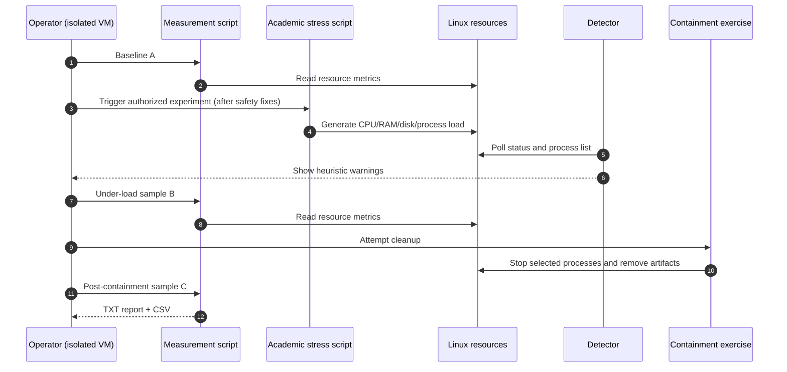

# Architecture and technical walkthrough

## System boundary

This repository contains an academic **Linux availability/observability experiment**, not malware that spreads or establishes persistence. The simulation generates local load; the detector reads operating-system statistics and temporary artifacts; the measurement script samples A/B/C scenarios; the cleanup and hardening scripts demonstrate administrative techniques but have significant safety limitations.

## Historical deployment and network boundary

**Reported execution environment:** Windows host running VirtualBox; Ubuntu Server guest executing the operating-systems lab; guest network adapter set to **Bridged Adapter**. The operator recalls connecting from Windows PowerShell to Ubuntu Server across the network (likely SSH; exact command/IP not confirmed).

```text
              Local area network (LAN)
                  /            \
       Windows host          Ubuntu Server guest
       PowerShell     <---->  VirtualBox bridged adapter
          |                    (Linux lab scripts)
          +-- runs VirtualBox ------+
```

The guest is **OS-virtualized but not network-isolated**. Bridged mode can put the guest on the same LAN as the host, potentially exposing listening services to LAN peers. For later hazardous workload testing, prefer a snapshot VM with host-only SSH (or an offline VM console), VM resource limits, and no unnecessary shared folders. Do not confuse the original lab's bridged connectivity with a safe, air-gapped environment.

## Modules and interface

| Script | Inputs | Relevant side effects | Output |
|---|---|---|---|
| `malware_sim.sh` | Interactive selection (CPU, RAM, disk, processes, all) | Launches child processes, writes under `/tmp` and `/dev/shm`, records process IDs | `/tmp/.malware_pids`, `/tmp/malware_activity.log` and temporary workload files |
| `detector.sh` | CPU/RAM/disk/process thresholds defined near top | Reads system information; overwrites `/tmp/detector_log.txt` | Alerts on terminal, detector log |
| `kill_malware.sh` | Global temporary PID file, matching process/file names | Sends `SIGKILL`, deletes matching files and directories | Terminal verification summary |
| `proteccion.sh` | Assumes `apt`, UFW, OpenSSH and privileged access | Installs packages; modifies system-wide networking/authentication/limits settings | Terminal output, host configuration changes |
| `medicion_desempenio.sh` | Interactive choice A/B/C/T/R | Samples host; writes temporary 50-MB disk test files, contacts `8.8.8.8` if network available | `/tmp/metricas_so/*.dat`, `.txt`, `.csv` |

## Data flow



## Metrics

The measurement script collects CPU usage, RAM utilization and available memory, disk utilization, approximate write/read bandwidth, ping latency, total/user process count, `/proc` listing response time, and 1-minute load average. Results are stored per scenario, then compared in a generated report.

**Methodology limitations:** Measurements are affected by sampling delay, caching, virtualization, locale-dependent output of Linux utilities, device contention, and network reachability. The result uses one host and must not be generalized to broader malware-detection accuracy or performance guarantees. A negative latency value (`-999`) is a missing measurement sentinel, not a valid ping time.

## Security model and assumptions

The original implementation assumes a disposable Linux VM, isolated from production networks. That assumption is written in comments but **not enforced in code**. The presence of a fixed duration is not sufficient to guarantee bounded child workload execution. The cleanup script's broad process matches are not process ownership verification. The hardening script is invasive and not idempotently reversible.

Read [SECURITY_REVIEW.md](SECURITY_REVIEW.md) before attempting dynamic validation.
